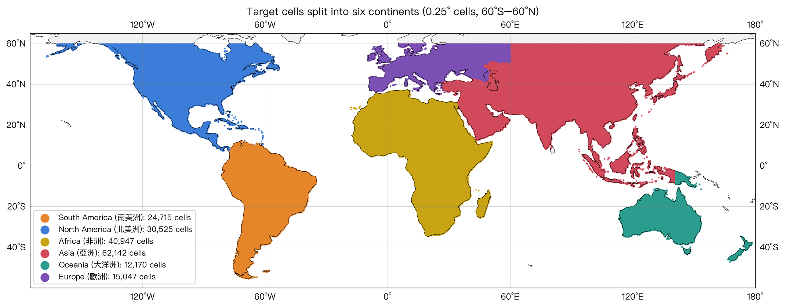

# Drainage curve 六大洲切割資料

本資料夾是把兩個 drainage curve 的 NetCDF 檔**依洲切割**後的結果：每個目標格點一條
drainage curve，取出 (x, y) 點，切成南美洲、北美洲、非洲、亞洲、大洋洲、歐洲六份，各存成 CSV。



## 資料夾結構

```
drainage_xy_by_continent/
├── README.md
├── raw_nc_data/    原始 nc 檔
├── divided_data/   切割後的 CSV
├── code/           切割與畫圖腳本
└── Figures/        切割圖與相關表格
```

| 路徑 | 說明 |
|---|---|
| `raw_nc_data/drainage_curves_allsources.nc` | 原始資料（來源含陸地與海洋），自 `data/` 複製而來 |
| `raw_nc_data/drainage_curves_land.nc` | 原始資料（只算陸地來源），自 `data/` 複製而來 |
| `divided_data/drainage_xy_{all,land}_{洲名}.csv` | 切割結果：12 個 CSV（2 個 mask × 6 洲） |
| `code/drainage_xy_by_continent.py` | 切割腳本：讀 `raw_nc_data/` → 判斷洲 → 輸出到 `divided_data/` |
| `code/plot_continent_split.py` | 畫六大洲切割圖、輸出範圍表到 `Figures/` |
| `Figures/continent_split_map.png` | 六大洲切割圖 |
| `Figures/continent_split_ranges.csv` | 每洲的格點數與緯經度範圍 |
| `Figures/drainage_xy_cell17460_check.csv` | cell 17460 與網站曲線的比對結果 |

## 原始 nc 檔

兩個 nc 檔結構相同：185,546 個陸地目標格點（`cell`），範圍 60°S–60°N、0.25° 網格，
2020–2025 合併。每個格點有 199 個累積份額 `level`（0.005 到 0.995）。

- `drainage_curves_allsources.nc`（mask = `all`）：來源含陸地與海洋，C 是佔**全部降雨**的比例。
- `drainage_curves_land.nc`（mask = `land`）：只算陸地來源，C 是佔**陸源降雨**的比例。

兩個檔的目標格點完全相同（`cell`、`tag_lat`、`tag_lon` 等一致），差別只在水氣來源的範圍，
所以兩組 CSV 的每洲格點數相同，但曲線的數值不同。

用到的變數：

| nc 變數 | 對應 CSV 欄位 | 說明 |
|---|---|---|
| `cell` | `cell` | 格點編號（0–185545） |
| `tag_lat`, `tag_lon` | `tag_lat`, `tag_lon` | 目標格點中心的緯度、經度 |
| `area_at_level` | `x_area_km2` | 累積到份額 C 所需的最小上游面積，km² |
| `level` | `y_cum_share` | 累積份額 C |

`total_source_area`、`run_group`、`terrestrial_share`、`rain_mmyr`、`dateline_flag`
沒有放進 CSV，需要的話回原 nc 檔取。

## CSV 內容

位置：`divided_data/`。檔名：`drainage_xy_{mask}_{洲名}.csv`，例如 `drainage_xy_all_亞洲.csv`。

每列是 drainage curve 上的一個點，每個格點 199 列。欄位：
`cell`、`tag_lat`、`tag_lon`、`x_area_km2`、`y_cum_share`。

注意：沒有補 (0, 0) 起點，第一個點是 C = 0.005。檔案很大（亞洲約 400 MB、約 1,240 萬列），
請用 Python（pandas）讀，不要用試算表。

## 切割方法

依每個格點的 `tag_lat`、`tag_lon` 判斷所屬的洲：

1. 以 Natural Earth 50m 國界（`ne_50m_admin_0_countries`）的 `CONTINENT` 欄位為準，
   格點落在哪個國家的多邊形內，就屬於該國的洲。
2. 落在海岸外（沒進任何多邊形）的沿岸格點，歸最近的陸地洲。
3. 修正 Natural Earth 的兩個問題：
   - 俄羅斯整個被標為歐洲 → **60°E 以西歸歐洲，以東歸亞洲**（圖上亞歐界的直線就是這條）。
   - 法國／西班牙的海外領地被標為歐洲 → 依位置改歸實際所在的洲：
     法屬圭亞那（經度 < −30°、緯度 < 8°）→ 南美洲；
     法屬安地列斯（經度 < −50°、緯度 ≥ 8°）→ 北美洲；
     加那利群島、馬德拉（經度 −30° 到 0°、緯度 < 34°）→ 非洲。

這是依國界切的，不是矩形經緯度框，所以各洲的緯經度範圍會互相重疊。

## 各洲範圍

| 洲 | 格點數 | 緯度範圍 | 經度範圍 |
|---|---|---|---|
| 南美洲 | 24,715 | −55.5° ～ 12.25° | −81.25° ～ −35.0° |
| 北美洲 | 30,525 | 7.25° ～ 59.75° | −167.0° ～ −53.0° |
| 非洲 | 40,947 | −34.75° ～ 37.25° | −18.0° ～ 51.25° |
| 亞洲 | 62,142 | −10.75° ～ 59.75° | 26.25° ～ 166.25° |
| 大洋洲 | 12,170 | −47.25° ～ −2.75° | 113.0° ～ 178.5° |
| 歐洲 | 15,047 | 35.0° ～ 59.75° | −9.75° ～ 60.0° |
| **合計** | **185,546** | | |

資料網格涵蓋 60°S–60°N，所以高於約 60°N 的地區（格陵蘭、北歐北部、西伯利亞北部）不在資料內。

## 洲歸屬的幾個約定

- **北美洲**：含中美洲（含巴拿馬）與加勒比海島嶼。
- **非洲**：含西奈半島（埃及）、馬達加斯加、加那利群島、馬德拉。
- **亞洲**：含土耳其、高加索三國、哈薩克、整個印尼（含西巴布亞，約 141°E 以西）、60°E 以東的俄羅斯。
- **大洋洲**：澳洲、紐西蘭、巴布亞紐幾內亞及太平洋島嶼（巴布亞島在約 141°E 被切成兩半，
  西邊屬印尼 → 亞洲，東邊屬巴紐 → 大洋洲）。
- **歐洲**：含冰島、英國、地中海島嶼（馬爾他、西西里等）。

## 如何驗證

用 cell 17460（41.0°N, 94.25°W，北美洲）和網站曲線對照：
`all` 與 `land` 各取 18 個點（C = 0.10 到 0.95），網站圖上讀到的 C 與 CSV 差在 ±0.002 內
（像素讀取誤差）。結果見 `Figures/drainage_xy_cell17460_check.csv`。只驗證了這一個格點。

## 重新產生

使用 `Geography` conda 環境，在 `code/` 內執行（路徑相對於腳本位置，從哪裡執行都可以）：

```bash
python drainage_xy_by_continent.py   # 讀 raw_nc_data/ 的兩個 nc，輸出 12 個 CSV 到 divided_data/（數分鐘，約 2.3 GB）
python plot_continent_split.py       # 讀 divided_data/ 的 CSV，輸出切割圖與範圍表到 Figures/
```

需要 `geopandas`、`shapely`、`cartopy`、`xarray`、`pandas`；國界資料用 cartopy 已快取的
`~/.local/share/cartopy/shapefiles/natural_earth/cultural/ne_50m_admin_0_countries.shp`。
